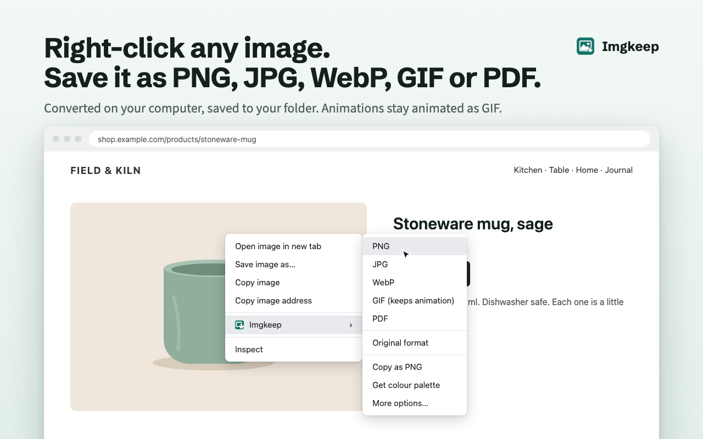

# Imgkeep

**Save image as PNG, JPG, WebP, GIF or PDF — free, open-source browser extension** for Chrome, Edge and Firefox. Right-click any image, pick a format, and Imgkeep converts it on your computer and saves it where you want. WebP and AVIF become files every app opens.

[](https://chromewebstore.google.com/detail/fkclfgbmjaafglfifenonfcahfdmajbl)
[](https://addons.mozilla.org/firefox/addon/imgkeep/)
[](LICENSE)

**Install:** [Chrome Web Store](https://chromewebstore.google.com/detail/fkclfgbmjaafglfifenonfcahfdmajbl) · [Microsoft Edge Add-ons](https://microsoftedge.microsoft.com/addons/detail/kokbmagcbobpjclpidebikeklmpafhhd) · [Firefox Add-ons](https://addons.mozilla.org/firefox/addon/imgkeep/) · **Website:** [imgkeep.app](https://imgkeep.app) · **No extension needed:** [free online image converter](https://imgkeep.app/convert/)



▶ [Watch the 30-second tour](https://youtu.be/A0kO0Whgqhs)

## Features

- **Save as PNG, JPG, WebP, GIF or PDF** from the right-click menu, or keep the **original format** untouched.
- **More formats in More options:** AVIF (often half the size of a JPG), ICO (16 to 256 px in one file, for favicons and shortcuts), BMP, and APNG (animated PNG in full colour).
- **Animation kept:** animated GIFs are saved as they are; animated WebP, AVIF and APNG become an animated GIF with their timing and transparency.
- **PDF:** one page, exactly the image's size; transparency kept.
- **Copy as PNG:** puts the image on your clipboard as a real PNG, ready to paste into a chat, document or design tool.
- **Get colour palette:** the image's 5, 8 or 12 main colours. Copy one as HEX, RGB or HSL, copy all as CSS variables, Tailwind, JSON or a list, or save a PNG swatch strip, a GIMP `.gpl` or an Adobe `.ase` file.
- **Find image here:** on sites that cover their photos with another layer (Instagram, Pinterest, Facebook, X, Tumblr, Flickr, Threads), finds the image under your click at its largest size. Off until you turn it on.
- **Keyboard shortcut and toolbar button** (0.15): point at an image and press **Alt+S** (Option+S on a Mac, Alt+Shift+S in Firefox) to save it in the format you used last; the toolbar button lists the images on screen to pick from. Uses the same setting as Find image here.
- **Save the full-size version** (Options, off by default): when a site shows a smaller copy made by its image service (Pinterest, X, Reddit, Etsy, Shopify, WordPress, Unsplash, Wikipedia), Imgkeep asks that service for the full-size file, and saves the image you clicked if it can't get it.
- **More options:** a live preview with the result's real size in pixels and kilobytes; choose format, maximum width, quality, the background colour for JPG and the file name.
- **Resize:** an optional maximum width scales larger images down, keeping their shape; smaller ones are never enlarged.
- **Your folder and file names:** save to Downloads, a folder you choose (Chrome and Edge) or ask every time, with an optional subfolder. Names from a template with `{name}`, `{host}`, `{site}`, `{title}`, `{date}`, `{time}`, `{w}`, `{h}`, `{original}` and `{n}`. Never overwrites a file.
- **"Last used" first:** your last format is offered again at the top of the menu.
- **Checked output:** each file's first bytes must match the format you chose, so you never get a mislabelled file.
- **51 languages,** following your browser's language; Arabic, Hebrew and Persian right to left.

## Install

- **Chrome:** [Chrome Web Store](https://chromewebstore.google.com/detail/fkclfgbmjaafglfifenonfcahfdmajbl) (Chrome 116 or newer)
- **Microsoft Edge:** [Edge Add-ons](https://microsoftedge.microsoft.com/addons/detail/kokbmagcbobpjclpidebikeklmpafhhd)
- **Firefox:** [Firefox Add-ons](https://addons.mozilla.org/firefox/addon/imgkeep/) (Firefox 140 or newer)

Store versions can lag a few days behind this repository while a release is in review.

## How to use

1. Right-click any image and choose **Imgkeep**.
2. Pick **PNG**, **JPG**, **WebP**, **GIF (keeps animation)**, **PDF** or **Original format**; or **Copy as PNG**, **Get colour palette** or **More options…**.
3. The file is saved to your Downloads folder, the folder you chose, or wherever you pick each time.

If the right-click doesn't reach a photo, choose **Imgkeep: Find image here…** or press **Alt+S** over it. If a site refuses to hand over its image, a small window asks whether to allow that one site; you can remove sites later in Options. Settings are in the extension's **Options**.

Step-by-step guides on imgkeep.app:

- [Why Chrome saves images as WebP](https://imgkeep.app/chrome-saves-images-as-webp/) · [Save WebP as JPG or PNG](https://imgkeep.app/save-webp-as-jpg-png/) · [Save AVIF as JPG or PNG](https://imgkeep.app/save-avif-as-jpg-png/) · [Chrome saves JFIF](https://imgkeep.app/chrome-saves-images-as-jfif/)
- [Save an animated WebP as a GIF](https://imgkeep.app/save-animated-webp-as-gif/) · [Save an image as PDF](https://imgkeep.app/save-image-as-pdf/) · [Web images into Canva, Figma or Google Slides](https://imgkeep.app/web-image-into-canva-figma-google-slides/)
- [When right-click won't save an image](https://imgkeep.app/save-image-right-click-not-working/) · Save images from [Pinterest](https://imgkeep.app/save-images-from-pinterest/), [Instagram](https://imgkeep.app/save-images-from-instagram/), [Google Images](https://imgkeep.app/save-images-from-google-images/), [X (Twitter)](https://imgkeep.app/save-images-from-x-twitter/), [Reddit](https://imgkeep.app/save-images-from-reddit/) or [Facebook](https://imgkeep.app/save-images-from-facebook/)
- [A safe alternative to Save image as Type](https://imgkeep.app/save-image-as-type-alternative/) · [The best Save Image As extensions, compared](https://imgkeep.app/best-save-image-as-extensions/) · [Imgkeep vs Save webP as PNG or JPEG](https://imgkeep.app/imgkeep-vs-save-webp-as-png-or-jpeg/)

### Known limits

- Very large images may exceed the browser's canvas limit ("too large to convert").
- GIF has 256 colours per frame and on/off transparency, and is limited to 600 frames, about 150 million source pixels in total and 90 seconds of work. Videos can't be saved as GIF.
- CSS background images and `<canvas>` drawings aren't offered as images by the right-click menu, and formats the browser can't decode (such as HEIC and TIFF) can't be converted.
- In Firefox there's no "A folder you choose" (Firefox has no folder access API): use Downloads or ask every time.
- After a browser restart, Chrome and Edge may ask you to reconnect your chosen folder with one click.
- Images on the browser's own add-on stores can't be saved: browsers keep extensions out of them.

## Privacy

From the [privacy policy](extension/PRIVACY.md) (also at [imgkeep.app/privacy.html](https://imgkeep.app/privacy.html)):

- **Your images never leave your computer.** Imgkeep reads only the image you choose, converts it on your computer and uploads nothing.
- **One anonymous daily summary of feature use** (counts like "12 saves as JPG, 1 failed", plus version, browser and language) is sent to PostHog's EU cloud. Never images, addresses, file names or identifiers. It's **on by default in Chrome and Edge and off in Firefox unless you allow it** at install, and you can turn it off in Options under "Anonymous usage counts", which also deletes anything not yet sent. Options shows exactly what's counted.
- **It doesn't read the sites you visit,** with exceptions you control: Find image here, Alt+S and the toolbar button look at that one page, at that moment, only when you use them; and a `blob:` image that only exists inside its page is read only after you allow the site. It never changes a page.
- **Network use:** the image you chose (or, with "Save the full-size version" on, its full-size file from the same image service), and the daily summary. If a site refuses an image and you allow it, Imgkeep repeats that one request with the site you were on as its Referer.
- **Permissions:** `contextMenus`, `downloads`, `storage` and `offscreen` at install; optional `activeTab`, `scripting` and `declarativeNetRequestWithHostAccess`, plus access to a site only when you allow it. Each is explained in [PERMISSIONS.md](PERMISSIONS.md).
- **No ads, no welcome tabs, no upsells.** Imgkeep asks for a rating after real use, at most three times, and stops as soon as you rate it or say no.
- **No remote code.** Plain JavaScript modules with no build step. The one compiled part, the AVIF encoder ([libavif](https://github.com/AOMediaCodec/libavif) via [@jsquash/avif](https://github.com/jamsinclair/jSquash), unchanged), is pinned by its SHA-256 and loads only when you save as AVIF. `tests/static-check.mjs` fails the build if permissions change, if network code appears outside `offscreen.js` and `lib/telemetry.js` (plus one in-page read for `blob:` images in `lib/read-blob.js`), or if extension files reference outside URLs.

## Build from source

The extension has no build step and no dependencies: the `extension/` folder is the extension.

**Chrome or Edge:** open `chrome://extensions` (or `edge://extensions`), turn on **Developer mode**, click **Load unpacked** and pick the `extension/` folder.

**Firefox:** Firefox needs a slightly different manifest (a background page instead of a service worker). Build it and load it temporarily:

```bash
npm install
npm run build-firefox
```

Then open `about:debugging#/runtime/this-firefox`, click **Load Temporary Add-on…** and pick `dist/firefox/manifest.json`.

**Tests** (Node.js 20 or newer):

```bash
npm install
npx playwright install chromium
npm test
```

## Contributing

Ideas and votes are welcome in [GitHub Discussions](https://github.com/ybider-tech/imgkeep/discussions/categories/ideas), and bug reports in [Issues](https://github.com/ybider-tech/imgkeep/issues). For code, tests, translations and how releases work, see [CONTRIBUTING.md](CONTRIBUTING.md). Changes by version are in the [CHANGELOG](CHANGELOG.md).

If Imgkeep helps you, a [rating on the Chrome Web Store](https://chromewebstore.google.com/detail/fkclfgbmjaafglfifenonfcahfdmajbl/reviews) or [Firefox Add-ons](https://addons.mozilla.org/firefox/addon/imgkeep/) helps others find it.

## License

[MIT](LICENSE). Vendored code keeps its own licence: [gifenc](https://github.com/mattdesl/gifenc) (MIT, noted at the top of `extension/lib/gifenc.js`) and the AVIF encoder (licence files in `extension/vendor/avif/`).
